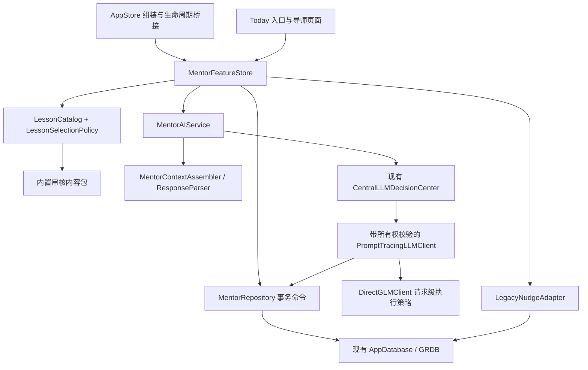
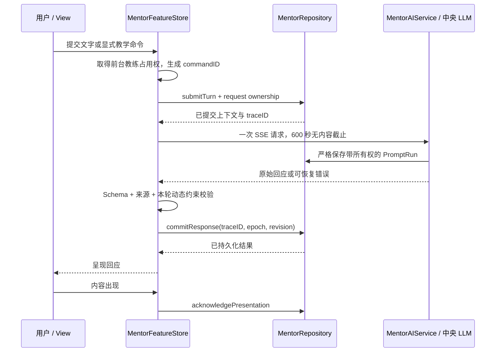

# 明思 M1 系统分析与设计

- 版本：1.0
- 日期：2026-09-10
- 依据：[首版 PRD](mingsi-mentor-m1-prd.md)、[产品总纲](mingsi-mentor-product-prd.md)
- 配套：[功能拆解](mingsi-mentor-m1-feature-breakdown.md)、[接口契约](contracts/mentor-m1/README.md)
- 状态：系统设计与接口契约；本文中的新类型、表、行为和测试均待实现，不代表 App 已交付

## 1. 分析范围与交付判断

目标是落实 M1 的完整产品包：三种开始方式、24 份离线教材、五类导师回应、表达草稿、自动保存、最近交流、同一事情的继续，以及可追溯的效果验证。保留五个 Tab 和既有 vNext 数据；不新增通知、跨主题记忆、后台工作记录接入或新的验证捷径。

每个功能的设计同时回答实用性、可能失效的方式和预期增益。增益在本文中是待验证假设；能够回看、来源正确等工程性质通过测试验证，是否启发用户必须通过真实使用验证。

## 2. 当前实现与差距

以下是当前工作区的事实，不是对已发布版本的判断。

| 当前事实 | 证据 | 对 M1 的影响 |
| --- | --- | --- |
| SwiftUI、iOS 17、GRDB、本地 SQLite、GLM BYOK | [工程配置](../project.yml)、[现有架构](technical-architecture.md) | 沿用原技术栈、数据库与 Keychain，不增加服务端 |
| AppStore 超过一万行，TodayView 超过五千行 | [AppStore](../Sources/App/AppStore.swift)、[TodayView](../Sources/Features/Today/TodayView.swift) | 新导师状态归独立功能 Store，避免把所有新状态继续放入旧主流程 |
| 单次点拨一行保存一轮；包含父轮与根轮 | [模型](../Sources/Domain/SingleNudgeModels.swift)、[仓储](../Sources/Services/VNextPersistence.swift) | 新交流采用会话加时间线；旧轮次由兼容读取适配，不无限追加可空字段 |
| 仓储接口只有 save、按日恢复和 latest | [接口](../Sources/Services/PersistenceCore.swift) | 新增列表、整链读取、事务命令、删除与版本管理 |
| CentralLLMDecisionCenter 仅转发请求 | [模型入口](../Sources/Services/CoreProtocols.swift) | 它不是互斥锁、质量门或超时管理器，不能把这些能力当作已存在 |
| 默认空闲超时 600 秒，最大重试参数为 2，另有 JSON 格式降级再发 | [传输实现](../Sources/Services/DirectGLMClient.swift) | 导师请求需要独立执行策略；仅把重试参数改为 0 仍不能保证一次 HTTP 请求 |
| tracing 在响应后保存，且使用 try? 吞掉写入失败 | [PromptTracingLLMClient](../Sources/Services/CoreProtocols.swift) | M1 需要严格的请求所有权和可失败的审计提交，不能提前显示成功 |
| 旧结束先更新可见状态，再异步排队保存 | [结束与保存队列](../Sources/App/AppStore.swift) | M1 的退出、切换与确认必须等待可抛错的事务回执 |
| 当前最新迁移 v52；已有 vNext 备份针对更早的迁移边界 | [迁移](../Sources/Services/VNextPersistence.swift)、[启动](../Sources/Services/PersistenceCore.swift) | 增加当前版本到导师版本的独立备份与恢复，不能恢复陈旧的 pre-vnext 库 |
| 导出枚举表名；没有完整的导师删除接口 | [导出与仓储](../Sources/Services/PersistenceCore.swift) | 新表、请求副本、临时导出都需纳入数据治理 |

以上代码仅用于确认接入点。本轮没有改动它们，也没有将旧测试结果当作 M1 验收结果。

## 3. 关键设计决定

| 编号 | 决定 | 选择理由、缺陷与控制 |
| --- | --- | --- |
| SD-01 | 一个 MentorFeatureStore 管理新导师体验；AppStore 负责组装与导航桥接 | 状态职责清楚；Today 的“明思一下”已接入同一多轮入口，旧点拨只保留历史兼容读取 |
| SD-02 | 与现有功能共用 AppDatabase，新建导师会话及时间线表 | 保留事务和导出基础；增加表的成本用于表达真实的所有权、版本和顺序 |
| SD-03 | 教材是有版本的资源，呈现时存完整内容快照 | 更新后仍能回看原文；少量正文重复存储可接受，不先建设共享内容平台 |
| SD-04 | 静态阅读、结束和确认已编辑文本不调用模型 | 零 Key 和离线入口成立；默认编辑内容不宣称个性化 |
| SD-05 | 用户材料的语义理解、相关教材选择与介入类型交给中央 LLM | 客户端只做来源、次数、权限与格式约束，不按关键词诊断用户 |
| SD-06 | 提交、呈现、确认、结束和删除分别是仓储事务命令 | 防止半成功；所有命令返回提交结果，不能以排队完成等同保存成功 |
| SD-07 | 请求带会话所有权、语义修订号和失效代次 | 拦住切换、纠正、删除后的迟到结果；本地取消网络后仍需存储层校验 |
| SD-08 | 请求执行策略按请求注入，不全局修改 GLM 默认值 | 导师流式请求采用 600 秒无内容截止、一次 HTTP；未启用流式的内部请求保留原总预算，避免破坏旧流程 |
| SD-09 | 旧点拨按原文兼容读取，继续时建立新会话关联 | 不重新生成历史，也不把旧 AI 结论变成用户认可的理解 |
| SD-10 | 阅读、流程结束、确认理解和具体获益分别记录 | 防止把正常退出或点击次数误写成成长，允许反馈缺失 |

## 4. 模块与依赖

建议新增文件位置，实际实现时遵循当前工程生成方式：

| 边界 | 建议位置 | 公开职责 |
| --- | --- | --- |
| 功能状态与动作 | `Sources/Features/Mentor/MentorFeatureStore.swift` | 页面状态、草稿缓冲、前台请求句柄、取消与恢复；不写 SQL |
| 页面 | `Sources/Features/Mentor/` 下入口、交流、理解编辑、最近列表、详情视图 | 发出用户动作，呈现状态；不直接调用模型 |
| 领域模型 | `Sources/Domain/MentorModels.swift` | Session、TimelineItem、RequestAttempt、Understanding、Feedback、SourceRef |
| 教材 | `Sources/Services/MentorLessonCatalog.swift`、`Sources/Resources/Mentor/` | 内容包校验、不可变目录、编辑顺序、候选过滤 |
| 模型服务 | `Sources/Services/MentorAIService.swift` | 组装请求、接收数据、结构与动态约束验证 |
| 存储 | `Sources/Services/MentorPersistence.swift` | 迁移、Row、事务命令、查询、删除与旧资料适配 |
| 共享接入 | 现有 AppStore、CoreProtocols、DirectGLMClient、PersistenceCore | 依赖注入、请求策略、严格审计、导出、启动能力门禁 |

先保持这些职责，不需要为每个动作建立一层 Service 或 UseCase。纯选择策略和解析器可以作为值类型放在对应文件内，只有复杂度增长后才拆分。

`AppStore.persistentStore` 注入同一数据库、Keychain 配置、中央 LLM 与 PromptProvider；`preview` 和现有 QA 构造路径需显式提供内存仓储或缺失依赖状态，不能悄悄创建正式数据库。资源由 `project.yml` / Xcode 工程资源阶段纳入 App，测试验证 Bundle 能读取完整内容包。

现有 AppStore 的后台处理会尝试延长部分 AI 工作。导师采用 PRD 的暂停取消策略，由 `handleScenePhase` 转发到 MentorFeatureStore；不能直接复用旧后台续跑行为。

## 5. 领域与持久化

### 5.1 数据对象

| 对象 / 建议表 | 关键字段与约束 | 说明 |
| --- | --- | --- |
| MentorSession / `mentor_sessions` | UUID PK；initial_entry；lifecycle；draft_text；draft_revision；semantic_revision；request_epoch；next_sequence；recall_count；origin_legacy_root_id；created_at；activity_at | lifecycle 仅 draft、active、paused、ended；跨日以 ID 恢复，dayKey 不是会话身份；旧根 ID 非空时唯一 |
| TimelineItem / `mentor_items` | UUID PK；session_id FK；sequence；kind；payload_json；request_id；supersedes_item_id；saved_at；presented_at | UNIQUE(session_id, sequence)；kind 为 user、assistant、lesson；已提交条目不可覆盖；教材 payload 含完整快照 |
| RequestAttempt / `mentor_requests` | trace UUID PK；session_id FK；user_item_id；request_kind；expected_revision；epoch；state；context_snapshot_json；protocol_version；started_at；deadline_at；terminal_reason | 调用前登记；一次主动重试是新 attempt，复用已有 user item；不重复新增用户原话 |
| UnderstandingRevision / `mentor_understandings` | UUID PK；session_id FK；group_id；revision；state；text；previous_revision_id；origin；confirmed_at | UNIQUE(group_id, revision)；draft 可编辑，confirmed 不可原位修改；修改确认理解产生下一版 |
| MentorFeedback / `mentor_feedback` | UUID PK；session_id FK；item_id；lesson_id；kind；created_at；revoked_at | not_relevant 仅当前会话；already_known 跨会话；撤销反馈只改变作用，不改原文 |
| SourceLink / `mentor_source_links` | session_id FK；一个 owner 引用；source_kind；source_id；source_version；content_hash；availability | owner 为 request、item 或 understanding，且必须恰有一个；核心所有权不藏在 JSON 内 |

SourceLink 的三个可空 owner 外键使用 CHECK 保证恰有一个非空；owner 与 session 的组合外键保证引用同一会话。来源可以是当前条目、旧点拨、闪念、教材或理解版本，来源类型使用固定枚举。外部来源的存在性与授权由仓储验证，不使用字符串 LIKE 判断关系。

所有导师子对象由会话拥有，可在删除会话时级联；被引用的闪念、vNext 事项和项目是借用来源，不能向上级联删除。请求的 source ID 必须对应实际装配进上下文的材料。

请求的 user_item_id 可空。点击“举个例子”等教学按钮仅登记 intent 和所选教材来源，不伪造用户原话条目。用户自己输入的“再举一个例子”虽然保留原文，也不能仅因存在 user 条目就推断已有可整理的个人理解；模型需基于具体表达提出草稿，语义质量另作验证。

状态枚举由领域模型固定：请求为 prepared、in_flight、response_received、committed、failed、cancelled、timed_out、interrupted；取消、超时、失败与中断均是终态，主动网络重试必须创建新 attempt。传输成功但保存失败时，将原始结果保留在内存并以同一 traceID 重试本地提交；不允许终态请求重新进入传输。视图等待、保存失败和呈现待确认是独立的短暂 UI 状态，不冒充会话 lifecycle。

索引至少包括：会话 `(activity_at DESC, id DESC)`、条目 `(session_id, sequence)`、请求 `(session_id, state)`、理解 `(session_id, group_id, revision)`、反馈 `(lesson_id, kind, revoked_at)`、来源 `(source_kind, source_id)`。最近列表使用 20 条一页的游标分页，以活动时间和 ID 消除同时间记录的不稳定排序。

### 5.2 教材快照与呈现

教材 ID 表示逻辑条目，version 表示内容版本；相同 ID+version 的内容哈希不允许变化。呈现时把标题、结构化正文、来源类型、引用和版本写入 lesson 条目，独立于未来 Bundle 更新。

`presented_at`、展示时的本地日期、时区及阅读位置存于 lesson 条目。位置采用内容段落标识和段内位置，字号变化时可以退回该段开头，不强行恢复已无意义的像素偏移。

保存回应和“已经展示”分开：先提交条目，再让视图在实际出现时调用幂等 `acknowledgePresentation`。去重和两轮追问计数以首次呈现确认计，不以 HTTP 成功计。确认写入失败时保留可见已保存内容，暂停依赖该计数的新一轮操作并允许重试本地确认，不重新请求模型。

### 5.3 理解版本

用户提交原话与 AI 草稿均不是自动确认的理解。AI 草稿的来源只能包含用户原话及其明确修正；教材可以解释背景，不能单独作为“用户获得收获”的依据。

用户只读后自己写一句时，origin 为 user_note，不调用模型。确认草稿创建 immutable confirmed revision；重新修改先复制为新 draft，旧确认文本仍可回看。取消编辑不覆盖旧确认版本。

删除一条“我的理解”删除其整组版本与当前相关草稿，防止旧版本在同页重新出现；会话原话保留。包含被删理解副本的未完成请求失效，已存派生摘要与引用按所有权清理或标记不可用。

### 5.4 草稿恢复

采用输入停止 500ms 后防抖保存，并在提交、切页、后台和切换会话前立即 flush。每个草稿带递增 draft_revision，SQL 更新只接受不旧于当前版本的写入，防止慢写覆盖新输入。

草稿修改不让已在处理的用户提交文本发生变化；已提交后的纠正另存新条目并递增 semantic_revision，使基于旧语义的未完成请求失效。纯阅读位置变化不递增 semantic_revision。

可编辑交流的用户条目可通过本地更正编辑器追加 supersedes_item_id 版本；draft 状态的借入材料也允许更正，无须先调用模型。原文、未发送草稿与借用来源不覆盖，取消或写入失败保留原内容；只读历史和已被替代条目不能原位更正。

数据库不可写时保留内存缓冲并明确未保存。放弃退出需确认，回退到最后一次已提交快照；不能把整个旧会话删除。进程在未成功落盘前终止时，无法承诺恢复该部分。

## 6. 事务命令与时序

仓储以命令暴露能力，不让视图或 Store 连续调用若干单行 save 冒充原子操作。

| 命令 | 前置条件 | 一次事务的结果 |
| --- | --- | --- |
| `saveDraft(sessionID, revision, text)` | 会话未删除，草稿版本有效 | 保存草稿和活动时间；空白未使用会话可不落盘 |
| `submitTurn(commandID, sessionID, text?, intent)` | 无当前导师请求；持久化可用；已有来源合法 | 有用户文字时保存原话条目；纯按钮只保存 intent；登记请求所有权、上下文快照、epoch / revision；同 commandID 幂等 |
| `correctUserItem(itemID, text)` | draft / active 可编辑会话；当前有效 user 条目；非空更正 | 保留旧条目并追加更正、登记 supersedes 关系、递增语义修订和 epoch、取消旧请求；不调用模型 |
| `presentLesson(commandID, sessionID, lessonSnapshot)` | 内容合法，符合候选条件或明确回看 | 保存教材条目与来源；重复同一呈现命令不新增记录 |
| `commitResponse(traceID, expectedEpoch, parsed)` | 请求及会话存在、代次和修订匹配、状态允许、审计已持久化 | 保存结构化回应或草稿、来源及请求状态；失败返回可重试本地提交 |
| `acknowledgePresentation(itemID)` | 条目已保存且尚未确认出现 | 标记 presented_at，更新去重与适用的追问计数；重复确认无影响 |
| `confirmUnderstanding(groupID, expectedRevision, editedText)` | 对应草稿未过期且来源有效 | 新建确认版本、关联来源、更新时间；不调用模型 |
| `pause / finish / switchSession` | 内存请求已取消或准备取消 | 持久失效在途请求、flush 草稿、更新状态；switch 成功后才激活新会话 |
| `deleteSession(sessionID)` | 用户确认了显示的删除范围 | 删除拥有内容及请求正文，失效来源和缓存，借用来源保留 |

提交下一轮时，未呈现回应门禁仅检查当前 semantic_revision 的请求结果。已被更正版本的旧结果不阻塞当前版本，也不补造旧 presented_at；当前版本仍需要真实呈现回执。

### 6.1 一次在线交流

没有 Key 时不创建模型 request attempt；已输入内容仍保存为草稿，并提供设置或静态阅读入口。调用开始前若已有旧 Today 前台训练占用，导师不追加另一段前台训练，但离线阅读可用。

在应用根建立一个轻量的前台教练占用状态，旧 Today 和新导师的发起命令都在 await 前取得占用，完成、失败和取消均释放。不能只禁用按钮而漏掉 Shortcut 或重试入口。它不宣称禁止所有既有后台 AI 工作；背景服务继续遵循原策略，来源仍严格隔离。

### 6.2 保存失败与结束

结束首先取消 Task 并使内存 epoch 失效，再尝试持久化失效及结束状态。成功后返回首页，失败则保留内容并提供重试保存或确认放弃未保存部分。

如果模型已返回、仅保存失败，重试执行本地提交，不能重新花费一次模型调用。若用户选择结束或更改原话，则先前未提交的 AI 结果不得在后续重试中越过 epoch / revision 检查。

启动恢复时将遗留 prepared / in_flight 请求视为 interrupted，不自动重发。显示已保存用户原话与“重试这一轮”；重试是新的 traceID，引用原 user item，避免恢复产生重复问句和双重计费。

## 7. 教材选择与实用性校验

### 7.1 决策顺序

1. 用户明确从历史回看指定条目时，允许读取其快照，不把它计为新的推荐。
2. 同日再次打开听讲入口时，恢复最近那份仍有效的听讲内容及位置。已经结束的会话先以阅读详情展示，用户要求交流后才恢复 active。
3. 首次使用 L01；之后按内容包唯一 `editorial_order` 从可用条目选择。L01 是显式的默认编辑内容，不声称根据职业诊断。
4. 新候选先排除无效或未审核版本、本会话已呈现条目、当前会话不相关主题、未撤销 already_known，以及过去 14 个本地自然日已呈现的逻辑教材 ID。
5. 静态听讲、转为阅读和“换一个”始终按本地编辑顺序选择，即使已经有当前话题也不触发网络。仅在用户主动发起的在线交流请求中，中央模型可以附带从可用目录选择相关教材或返回 null；不为选题单独追加请求，也不写入长期兴趣判断。
6. 用户“换一个”属于新选择，仍遵守去重；耗尽则提供已读内容和结束，不循环伪造新内容。

14 天窗口定义为当前本地日期及此前 13 个自然日；展示日期和时区作为事实保存，不重写历史。测试使用注入 Calendar / Clock，覆盖午夜、时区切换和设备时间变化。设备时间大幅倒退时保持已有排除事实，不自动批量把内容标成未读。

“不相关 / 已知道”优先于同日自动恢复：用户明确拒绝当前教材后，当前听讲恢复指向失效，进入新的候选选择。明确回看历史仍允许；不是把同一教材强行继续推荐。

### 7.2 版本与反馈

去重、已知道按逻辑教材 ID 生效，不因内容升级自动复活；用户从设置重置已知道时，记录 revoked_at，保留交流原文。重置不会删除 14 天呈现事实，也不绕过当前会话的排除。

反馈拥有会话来源。删除会话后其反馈不继续影响推荐；若另一会话仍有同条有效反馈，排除继续生效。展示记录删除后从剩余事实重建候选，不保留隐藏的私人兴趣画像。

### 7.3 内容包契约

使用 [lesson-pack.schema.json](contracts/mentor-m1/lesson-pack.schema.json)。发布包必须有 24 个唯一 ID、24 个唯一编辑序号、六组各四条，包含 L01 和 L02。Schema 验证结构和数量；唯一字段、分类分布、哈希与正文质量由内容包检查器及人工审核保证。

教材显示以 title、claim、example、boundary 和可选 observation 为自然段组织。schema 中允许较大的字符串上限用于结构安全；PRD 的约 250-400 字是编辑质量目标，不通过机械截断来满足。

24 份内容可能在频繁换题时耗尽，这是明确的可用状态。第一版的增益需要通过“内容是否具体有用”证明，不能只依靠默认顺序或数量。若用户反复认为 L01 不相关，先调整默认内容或增加可跳过的方向选择，再验证，不直接建设复杂推荐系统。

## 8. 模型协议、上下文与边界

### 8.1 请求与输出

新增两个版本化 PromptID：`mentorRespond`、`mentorDraftUnderstanding`，均路由到现有 coach 决策路径；内部不暴露训练模式术语。旧 singleNudge 协议保持可解析，不原位替换历史版本。

响应契约分别为 [turn.schema.json](contracts/mentor-m1/turn.schema.json) 与 [understanding.schema.json](contracts/mentor-m1/understanding.schema.json)。输入包含 initial_entry、当前 intent、当前会话来源、教材目录或已选教材全文、recall_count、是否允许继续补材料、schema / prompt / 内容版本。

来源键使用有类型的稳定字符串，例如 `item:<uuid>`、`capture:<uuid>`、`legacy-nudge:<uuid>`、`lesson:L01@1.0`、`understanding:<uuid>`。返回来源只能是实际输入集合的子集；不得通过字符串前缀猜测真实记录存在。

`action` 是 clarify、explain、compare、advise、close 之一；`material_status` 是 missing、usable、not_needed，由模型说明当前材料状态。客户端不根据用户字数或行业推断状态。

响应使用 schema_version、action、material_status、body、question、question_purpose、source_refs、lesson_ref、suggested_actions；协议版本固定为 1.0.0。lesson_ref 非空时同时包含 id 和 version。question_purpose 为 null、material 或 reflection；无问题时必须为 null，有问题时必须说明用途。教材正文来自所选版本的本地审核快照，不能用模型正文替换该快照。

`suggested_actions` 只允许 reply、explain、another_lesson、draft_understanding、finish。客户端根据本地状态求交集并决定唯一主要操作；它们只是建议，不会执行写入、通知、验证或成长副作用。

### 8.2 补材料上限与用户主权

对话支持多轮，每轮推进一个主要思考动作；两次上限只限制补材料问题数，不限制用户继续交流。老师回答后，用户仍可补充、追问、纠正，或选择结束。

回看首轮的具体入口不计入 AI 补材料次数。存储只豁免 initial_entry=review、intent=review、无用户条目且会话中首条回应的请求；后续请求即使标记为 review 也不能重复获得豁免，首次已带用户材料的请求仍按实际问题计数。其余主动作只要附有 question_purpose=material 的问题，就在首次实际呈现时递增 recall_count；material_status=missing 且有问题时也按补材料计。讲解和比较不豁免，同一条目重复打开不重复计数。

count 达到 2 后，输入禁止任何主动作附带新的补材料问题。若模型返回 question_purpose=material，或 missing 且有问题，动态验证拒绝该结果；界面提供明确的教材入口与结束，不生成本地假讲解。用户主动选择“继续回忆”可以开启新的明确探索段并重置该段预算，不能由模型自行解锁。模型将补材料问题误标为 reflection 的风险通过语义反例评估检验，Schema 和枚举本身无法证明分类正确。

“继续回忆”只在回看预算已用完、当前回应已呈现且没有正在执行的请求时提供。该动作先保存草稿，再执行幂等本地命令开启新段，保留对话与输入并聚焦编辑器；本身不调用模型。保存失败保留原预算并允许重试；下一次主动发送使用新的预算与请求代次。历史查看不提供此写入操作。

用户请求直接听讲时不允许以补材料问题替代教学；用户没有提交自己的表达时，不启用理解草稿生成。上述动态检查需要原请求和会话状态，不能只依赖 JSON Schema。

### 8.3 上下文预算

首版不做跨主题检索。默认携带当前首次有效问题、最近六组完整问答、当前教材全文或目录，以及用户主动选择的当前理解。过早问答仍保留在本地。

`conversation_state.visibleTurnIndex` 按完整时间线计算，不随最近六组窗口、预算裁减或显式材料选择缩小。普通用户追加表达时，最近一段老师回应与新表达一起保留，保证“这是什么意思”等追问有明确指代；必要的相邻交流组仍超限时进入材料选择，不能静默删掉老师回应再作答。显式选择后只发送用户选中的材料。

上述窗口受纠正关系约束：保留一条旧材料时，必须同时带入针对它的最新有效纠正，并标明被替代版本不可作为当前事实。显式修改原条目以 supersedes_item_id 建立关系；自然对话中的纠正无法可靠映射时，一并保留后续用户原话，不能只固定最初问题并丢弃修正。预算不足时移除整组旧材料，或请用户选择本轮应采用的事实片段，不由本地关键词擅自裁决。覆盖“纠正已早于最近六组、再次继续仍使用修正事实”的用例。

明确更正之前的 assistant 条目保留正文，但其来源标为 isCurrent=false；响应来源验证不允许把这些历史回应重新引用为当前依据。

采用序列化后 24,000 字符的初始请求上限作为可调整的工程预算，并校验所选模型的实际上下文限制；它不是精确 token 计量。超限先减少教材目录摘要和非当前旧轮次，不能静默截断用户最新原话或其明确指定的来源。

若必需材料仍超限，保留全文，提示用户为本轮选择片段；来源列表显示此次实际发送范围。原话、老师正文和老师提问分别由用户主动选择，老师片段只用于上下文而非用户事实；不从未选字段或内部引用带回旧材料。有新输入时至少保留其一个片段，当前请求不能被历史片段取代。选择页可展开查看实际发送的完整片段；已选交流组不再按六组窗口静默删减，超限则重新选择。用户询问没有发送的旧材料时，应允许选择那条记录补入，不能编造记忆。预算及删减策略需有固定案例验证，避免节省调用成本却损坏思考连续性。

### 8.4 防止内容变成指令

用户材料和教材正文通过结构化 payload 作为数据发送，系统政策与用户引用内容分别装配。引用中的指令不能改变来源约束、输出协议或触发工具。M1 没有模型工具执行能力；语义上的误导、建议是否越界仍由黄金案例与人工评估验证。

## 9. 请求执行与审计

在 `LLMRequest` 增加可选执行策略，存量请求缺省保持原行为。导师策略固定 `maxHTTPAttempts=1`、`allowsFormatFallback=false`、`traceOwner=sessionID / requestID`。生产回应与整理理解携带同一请求专属 `MentorStreamProgress`，流式空闲预算为 600 秒；没有进度通道的内部请求保留普通 API 30 秒／Responses 120 秒总预算。不要只改 DirectGLMClient 初始化参数而保留 completeAttempt 的无 JSON 自动重发。

2026-10-22 起，导师回应与整理理解均以 SSE 接收，并在页面逐步显示正文或理解草稿的预览。页面、审计网关和网络执行器共享最后一个非空输出文本 token 的时刻：首个内容之前从提交开始最多等 600 秒；有内容则重新计算 600 秒无内容截止，持续输出不受旧 30／120 秒总时限截断。心跳、生命周期事件和推理片段不延长应用层内容预算；URLSession 的默认请求空闲预算也为 600 秒，配置了更短传输预算时仍可能更早失败。十秒仍显示等待提示。策略及进度通道随单次请求捕获，配置刷新只影响新请求。没有进度通道的内部 complete 请求保留原总预算。此改动不是网络或供应商稳定性保证；原失败和新验收分开记录。UI Watchdog 与网络 Task 分离，超时后先恢复可操作状态、失效请求并取消网络；不能等待一个不响应取消的测试客户端后才退出。真实 URLSession 任务必须取消，迟到回调仍通过 epoch 和存储检查。

GLM-5.3 和 GLM-5.3-Flash 在官方 `api.z.ai` / `open.bigmodel.cn` 接口上默认最高推理强度，且不能关闭思考。导师带前台执行策略的请求显式使用 `reasoning_effort=low`，以适配即时交流；不发送不支持的 `thinking.type=disabled`。其他模型、代理接口及非导师请求不注入此扩展。一次 HTTP 尝试及上述流式空闲预算保持有效，模型设置降低等待开销，不构成服务延迟保证。

PromptTracingLLMClient 对带导师所有权的请求使用严格仓储方法 `saveOwnedPromptRun`：校验请求存在、会话未删除、状态允许、epoch / semantic_revision 一致，再原子保存 PromptRun 和传输结果状态。写入失败抛错，不使用 try?。存量请求保留原路径，避免扩大此次行为变化。

流式仍通过 `complete` 的审计路径，不能调用会绕过导师审计的通用 `stream`。只从顶层 JSON 的 body／text 解码可读预览，不显示键、引用或推理内容；预览最多接收 128KB 原始输出。必须收到 Responses completed 或 Chat stop + DONE，随后通过既有格式、来源、质量门与事务提交，才写为完整回应。断流保留本页的可复制预览但不写为完成条目；预览仅在内存，退出或重启不能承诺恢复。重试新建 attempt，不续传、不自动修复或重发；取消后的迟到内容按代次拒绝。

审计的“收到回应”和条目的“呈现成功”分开。结构无效的回应可以作为拥有明确会话来源的审计失败保留，但不得计为已完成或成长。审计存储失败时不得继续显示已保存的成功结果；重试保存复用内存中的原始回应。

API Key / endpoint / model 配置变化时，取消当前导师请求并刷新服务依赖；已分配请求保存其实际使用的模型标识。静态阅读和未提交草稿不受影响。密钥不得进入请求快照、日志或导出。

## 10. 删除、导出与迁移

### 10.1 删除的竞态防护

1. UI 明确删除范围并确认；Store 使本地请求失效并取消网络。
2. 事务内校验会话仍存在，清理所属条目、草稿、理解版本、反馈、来源快照、请求与 PromptRun 原文。
3. 会话及请求记录删除后，严格审计方法因 owner 不存在拒绝迟到写入，不允许 upsert 重建 owner。
4. 事务成功后失效内存缓存、待保存缓冲及应用管理的临时导出文件，清空 preparedDataExport。
5. 事务失败时保留原库，界面显示删除失败；本地取消依然有效，用户可重试删除。

不需要永久保存用户内容作为删除墓碑。不存在的 owner 只能被显式的新建命令创建，响应与审计写入绝不具有该权限。若需要故障统计，只保留不能重建私人内容的错误码与时间。

用户已经另存或分享的导出副本不在 App 控制范围。App 自己管理的迁移备份若含被删除材料，也需作废或用删除后的当前库重新生成；不得在随后恢复时复活数据。

### 10.2 旧点拨兼容

LegacyNudgeAdapter 按 root_session_id 读取完整链，保留 input、question、answer、diagnosis、父轮、日期及两个 PromptRun。父引用缺失或循环时仍可查看有效原文，阻止有歧义的自动整链续接，允许用户明确选取一段开始新交流。

首次继续一条完整旧链时，建立唯一 origin_legacy_root_id 的新会话，旧内容投影为只读时间线；未发生继续前不批量拷贝。最近列表将已有新包装的旧根合并展示，避免重复出现。

混合历史每页最多 20 条，新会话与未包装旧根各自保留精确数据库游标及尚未展示的轻量摘要，按活动时间与 ID 合并；不能截掉未展示条目后推进该来源游标。完整一页成功才提交可见列表与游标，失败保留已加载范围。旧根列表仅取 80 字预览，不加载完整轮次和 PromptRun；完整链在打开详情后读取。首页继续入口独立查询两类来源的最近未结束记录，不受最近三条预览限制。详情返回或删除后刷新已加载页数，分页仍是实时记录而非冻结快照。

删除这个由旧根延续的整段交流时，确认框说明包括所属旧轮次与新轮次，事务清理该唯一旧根所属链及其私有请求副本；借入的闪念与 vNext 事项仍保留。用户主动选取旧片段创建的独立新会话仅借用来源，不拥有原旧链。这样既避免删除后旧根重新冒出，也避免误删无关资料。

### 10.3 迁移及回退

当前最高 v52，本设计暂定新增 `v53_mentor_m1`；实施前重新检查迁移注册，若已占用，顺延并统一更新相关测试，不改写已有迁移。

迁移前基于当前实际数据库制作独立、可验证的一致性备份，继续使用 SQLite 在线备份与文件租约。覆盖 AppIntent 同时打开同一库的情况，不能直接复制一个未检查 WAL 的 sqlite 文件。

为 AppDatabase 增加导师迁移能力边界。v52 到 v53 失败时恢复这一轮的当前库快照，再以最多迁移到 v52 的配置打开旧功能，显式禁用 Mentor 仓储；不能回退到陈旧 pre-vnext，也不能让有真实旧数据的用户静默进入临时内存模式。

成功开放新写入之后的功能回退仅禁用新入口并保留只读 / 导出支持，不能恢复迁移前备份覆盖新增数据。永久结构修复另增迁移，不修改已应用迁移。

导出白名单增加全部导师权威表及来源关系；已删除内容采用实际清理，不能依赖当前导出逻辑自动过滤软删除。保留内容包版本与来源信息；不导出 Keychain、内存执行句柄及可重新生成的缓存。

## 11. 交互与非功能检查

| 场景 | 必须实现的系统行为 | 预期增益 |
| --- | --- | --- |
| 无历史、无 Key | L01 离线加载，零网络请求，允许正常回看和结束 | 用户可以先体验内容价值 |
| 输入后跳到设置 | flush 草稿，返回时恢复原会话；不自动发送 | 减少首次配置导致的材料丢失 |
| 离开 / 后台 / 新事情 | 取消导师请求，保留已有条目和草稿，旧响应失效 | 避免重复调用与上下文串线 |
| 保存失败 | 允许重试本地提交或确认放弃未保存部分 | 明确数据边界，不困住用户 |
| 最新教材更新 | 已读详情使用原快照，新推荐使用审核后的当前版本 | 证据不被后来的文案修改 |
| 大字号与键盘 | 主动作可达，正文滚动，结束始终可发现 | 忙碌时少一次寻找与误触 |
| 长历史 | 游标分页、按需读取，Prompt 只带可解释的当前范围 | 可持续使用而不让每次请求膨胀 |

本地反馈 100ms、教材可读 1 秒和在线流式 600 秒无内容截止按 PRD 检查；前两项在规定设备上实测并报告分布，后者用缩短的测试策略验证持续内容续期和停流截止。数据库读写不阻塞主线程，首屏不加载全部 PromptRun 或历史正文。

## 12. 实用性、缺陷与预期增益评审

### 12.1 试用观测的实现边界

F18 增加本地辅助表 mentor_usage_events，与六类业务权威表分开。字段为 event_id、attempt_id、可空 session_id、event_kind、occurred_at 和受白名单约束的 attributes_json。入口点击先建立 attempt_id；真正产生会话后关联 session_id，空白退出只留不含正文的尝试事实，不创建空交流。

事件至少区分 entry_started、content_presented、request_finished、session_left、understanding_confirmed、benefit_feedback。属性仅允许初始入口、切换入口、是否有材料、版本、耗时、呈现类别与首份标记、退出阶段与动作、原因及反馈枚举；缺失反馈为 unknown。一次会话的多次重新进入使用不同 attempt_id，同次尝试对同一内容的重复呈现确认不重复发事件。已关联会话的事件随删除清理，导出时登记该表。

| 属性 | 口径与边界 |
| --- | --- |
| entry / switched_entry | entry 在尝试开始时固定；切换另外记录。开启另一会话的退出事件记录目标入口，同次尝试从回看／交流转入静态教学或听讲后提交个人材料也记录实际路径变化；恢复已经进入个人讨论的内容不重复算切换 |
| has_material | 初次点击时有无材料，不因后续输入改写入口事实 |
| content_version / schema_version | 有教材时记录包或实际教材版本；无包为 unavailable，模型正文为 model-only；响应协议单独记录 1.0.0。内容版本限数字版本或上述受控标记，不接收任意描述 |
| first_content / presentation | 每次尝试首份完整内容单独标记。new 表示新建领域呈现回执，revisit 表示已呈现内容恢复或只读历史查看；复看不算新推荐、新收获。只读历史只写观测事件，不补写领域回执。回执本地重试保留首次实际观察时间 |
| duration_ms / timing_scope | 非负整数毫秒。entry_to_content 为入口到视图确认呈现的单调时钟间隔；request 为进入等待到传输返回、抛错、取消或超时；attempt 为入口到实际退出。保存重试中的用户等待不增加原请求耗时 |
| exit_phase / exit_action / reason | 离开前的 editing、reading、submitting、understanding 等受控阶段，与 finish／pause／switch 动作分开；失败入口使用 entry 阶段及 entry_failed／entry_cancelled，不复制错误正文 |
| feedback | 只接受获益、已知道、不相关等固定枚举；缺失事件不推断为负面反馈 |

入口事件串行排队，后来导航或取消不取消前一观测写入。请求与呈现回调携带原尝试归属，迟到结果不能归到新入口；请求终态成功落盘后才发终态事件，重试本地终态写入不重复计数。创建空白交流的首个真实材料时关联原尝试，空白退出仍不创建业务会话。观测写入是尽力保存的辅助记录，失败不阻止业务保存或导航；报告必须承认这类缺失，不宣称日志是所有使用的完整分母。key 与 value 均进行白名单和类型校验，合法 key 里夹带私人正文也拒绝。

具体获益描述属于用户自愿填写的会话反馈，由 mentor_feedback 保存并按会话治理，不进入 usage_events 或通用日志；它与不相关、已知道反馈使用不同 kind。“为什么没有打开 App”不能由埋点推断，通过试用记录自愿补充。试用报告注明删除造成的样本缺失，不为保持指标而保留已删私人数据。

### 12.2 风险与增益

| 风险 | 性质 | 处理与观察方式 |
| --- | --- | --- |
| 默认 L01 与部分用户无关 | 产品假设 | 保持可换题；分别记录不相关与已知道，依据试用决定是否改变默认，不宣称个性化 |
| “收工时使用”仍不足以让用户想起 App | 产品假设 | 记录自然启动和未打开原因；证据支持后才独立验证提醒，M1 不偷加通知 |
| 两轮限制太早或太晚 | 可调交互策略 | 记录无片段退出和主动继续情况；显式放宽，不由模型暗中忽略上限 |
| 24 份教材不够或缺乏教学价值 | 内容风险 | 正文审核、耗尽状态和真实获益分开验收，数量达标不能证明有效 |
| 助手将教材观点写成用户理解 | 语义风险 | 草稿来源限制、用户确认、反例评估；Schema 无法证明语义真实 |
| 保存与结果展示先后不一致 | 当前实现不适配 | 新仓储事务回执，写入故障注入，禁止沿用先成功后排队保存 |
| 超时后远端继续产生费用或迟到结果 | 传输风险 | 取消 URLSession、请求级一次 HTTP、失效代次和严格写入检查；不保证供应方取消后的计费政策 |
| 已删除内容被 tracing、备份或导出带回 | 数据风险 | 所有权事务、迟到写入拒绝、应用备份和临时文件治理 |
| 旧流程或 AppIntent 被新迁移破坏 | 集成风险 | 当前库一致性备份、租约、上限迁移能力、旧功能回退演练 |
| 用户只读被统计成成长 | 评价风险 | exposure、end、confirmed、benefit 分离；缺失反馈标 unknown |

增益判断分三层：可用性由流程与恢复测试证明；即时帮助由用户描述证明；长期复用由后来的实际事情证明。M1 只提供后两者的记录基础，不提前宣称效果。

## 13. 验证与落地边界

接口契约与示例已完成标准 JSON Schema 检查，范围和实际结果见 [设计交付检查](mingsi-mentor-m1-design-audit.md)。动态来源、两轮上限、并发、删除、实际模型语义、迁移和界面必须在后续实现中验证，不能从契约检查通过推断产品完成。

功能拆解提供 FR-01 至 FR-08、T01 至 T18 和 WP-01 至 WP-06 的全量映射，并增加本文发现的迁移、迟到写入、版本与反馈边界用例。

本文的 v53、新类名、文件位置及预算是本版系统设计；开发可调整内部组织，但不能省略所有权、事务、恢复和产品结果。需要改变产品行为时先更新 PRD 与对应验收，再实施。
