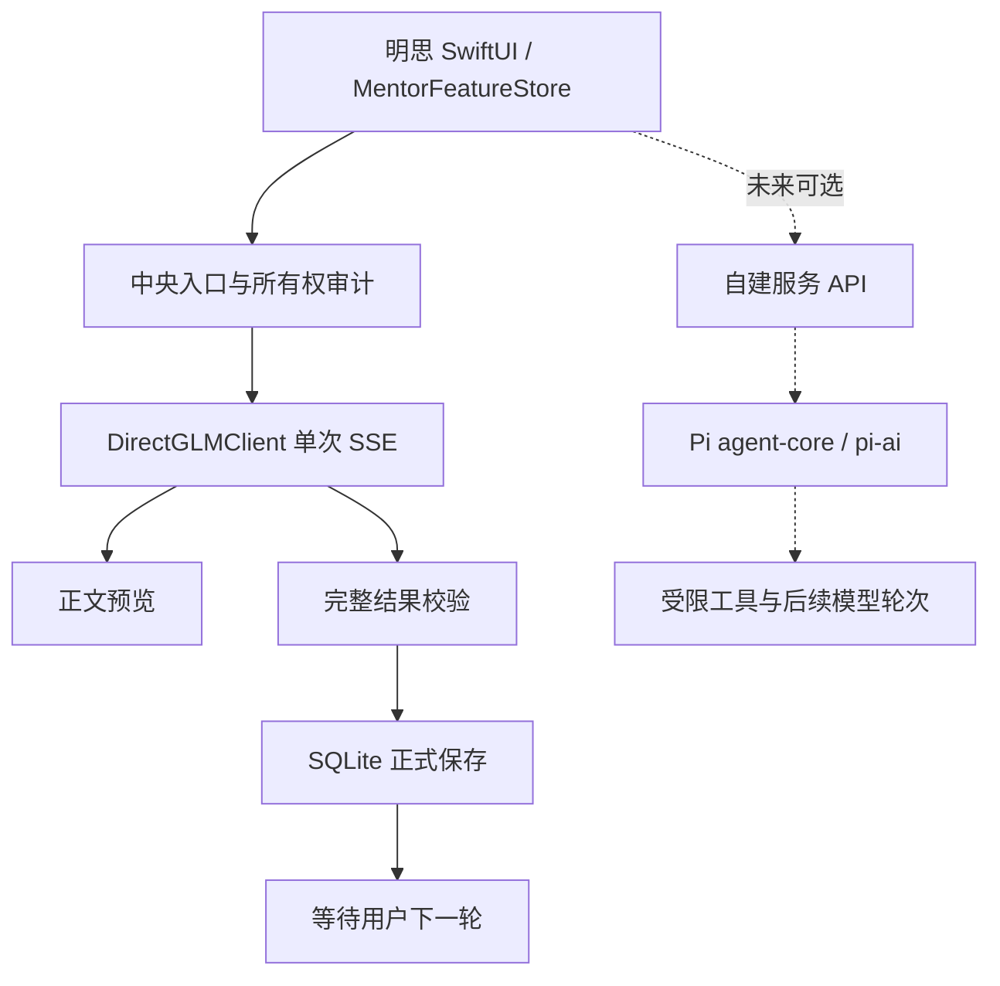

# Pi / pi-mono 对明思的接入评估

检索日期：2026-10-22。用户已确认「派」指 Pi。使用已认证 gh 读取元数据和固定提交 `bd3c9b823762b7383954aa49e13ee350471015fe` 的实际源码；旧 `badlogic/pi-mono` 在 API 中重定向到 `earendil-works/pi`。未安装、执行或接入 Pi，以下运行兼容性判断是源码分析，不是 PoC 结果。

## 结论

当前目标是原生 iOS 可靠多轮交流，继续使用 Swift 原生请求生命周期的收益更高。Pi 值得在明思以后需要自主检索、工具编排和多步研究时再接入；它不是 SSE 超时或上游故障的修复开关，不提供订阅额度。

Pi 的总体机制为：应用消息转换为模型上下文 → provider 流式事件 → assistant／工具调用 → 工具结果回填 → 按工具、steering、follow-up 或 finishTurn 决策继续。无工具和继续条件时退出。agent-core 管循环，pi-ai 管供应商事件适配，coding-agent 另有会话、压缩和重试层。不能把高层 CLI 的所有能力当作 agent-core 默认能力。

虚线是建议架构，不是已实现路径。当前没有自主工具执行。

| 需求 | Pi 源码能力 | 明思当前能力／接入影响 |
| --- | --- | --- |
| 逐步显示正文 | pi-ai 的 text_delta，经 agent message_update 输出 | 已原生实现 SSE 正文预览，无需更换框架 |
| 慢响应不中途按旧总时限结束 | Loop 负责事件和取消，provider 仍会报错 | 已改为持续内容续期／600 秒无内容截止；仍需处理网络与系统限制 |
| 出错后继续 | agent-core error／aborted 硬退出；coding-agent 可配置退避后续请求 | 当前手动新 attempt，避免自动重复消耗；Pi 重试不等于原流续传 |
| 自动查历史、调用资料工具、再作答 | 有工具执行、结果回填和继续决策 | 这是未来有价值的新增能力，需定义只读工具、范围、最大轮次／成本、取消及审计 |
| 统一多供应商 | pi-ai 有 provider 工厂与 Chat／Responses 适配，支持浏览器打包 | 可扩展面更广；现有伊莉丝仅验证明思自有 Responses 客户端，未证明其 Pi 兼容性 |
| SwiftUI 原生接入 | npm ESM／TypeScript 包；引擎要求 Node >=22.19；无 Swift Package | 不能当 Swift 依赖直接引入。可做 JS 桥接或远程服务，都增加运行与状态映射成本 |
| 跨设备、后台执行 | RPC 为 stdin／stdout JSONL 的长驻子进程 | 不等于手机可连接的 HTTP 服务；Mac／NAS 需另建认证与流式转发层，后台可靠性也需另测 |
| 当前数据可信保存 | Pi 有自己的消息／会话机制 | 不能替代明思 request epoch、来源校验、PromptRun 和 SQLite 事务，需重新对接 |

## 可选方案与推荐时机

1. **当前采用：原生受控循环。** 准备上下文 → 一次流式生成 → 校验保存 → 用户决定下一轮。已补齐等待、预览、失败和取消；不是自主工具 Agent。
2. **未来优先评估：服务端 Pi。** 在 Mac 或 NAS 运行一个小服务，用 agent-core／pi-ai 提供只读历史检索与指南查找等工具；iPhone 只接收应用层事件。先限制模型轮数与工具轮数、关闭默认自动重试，并把每次实际模型请求和工具调用纳入审计。没有部署或给 Pi 传递凭据。
3. **暂不推荐：iOS 内嵌 JS 桥。** pi-ai 声明浏览器支持，但 WKWebView／JavaScriptCore 的 fetch、事件流、AbortSignal、打包、Keychain 桥和生命周期仍需逐项验证。没有理由为已有对话能力承担这部分成本；源码没有证明无法实现，也没有证明开箱即用。

若未来只需要检索几条已授权历史再回应，可以先用 Swift 的受限工具循环，达到明确多供应商或服务端执行需求时再比较 Pi。是否引入应按具体工具和运行位置决定，不能把额外模型自检循环自动视为更好的回答或更省额度。

## 固定源码证据

- [agent-core README](https://github.com/earendil-works/pi/blob/bd3c9b823762b7383954aa49e13ee350471015fe/packages/agent/README.md)：事件流程、工具模式、prepareRequest／finishTurn、取消与继续接口。
- [agent-loop.ts](https://github.com/earendil-works/pi/blob/bd3c9b823762b7383954aa49e13ee350471015fe/packages/agent/src/agent-loop.ts#L250)：error／aborted 在 254–264 行结束；267–327 行按工具及继续条件调度；390–480 行适配流式部分消息。
- [agent-core package.json](https://github.com/earendil-works/pi/blob/bd3c9b823762b7383954aa49e13ee350471015fe/packages/agent/package.json)：npm ESM／TypeScript 导出与 Node >=22.19 引擎。
- [pi-ai package.json](https://github.com/earendil-works/pi/blob/bd3c9b823762b7383954aa49e13ee350471015fe/packages/ai/package.json) 与 [浏览器说明](https://github.com/earendil-works/pi/blob/bd3c9b823762b7383954aa49e13ee350471015fe/packages/ai/README.md#browser-usage)：JS 依赖、provider 包、浏览器支持与 Node-only OAuth 限制。
- [RPC 文档](https://github.com/earendil-works/pi/blob/bd3c9b823762b7383954aa49e13ee350471015fe/packages/coding-agent/docs/rpc.md)：Node／Bun SDK 与子进程 JSONL 边界；agent_end 不等于高层自动恢复结束，后者使用 agent_settled。
- [coding-agent 重试实现](https://github.com/earendil-works/pi/blob/bd3c9b823762b7383954aa49e13ee350471015fe/packages/coding-agent/src/core/agent-session.ts#L3813)：可配置退避、最大次数、错误请求恢复处理。不能把它描述为原 SSE 断点续传。

仓库树中未发现 `.swift`／`Package.swift`。本轮没有验证 Pi 的本地执行、伊莉丝连接、断流恢复、手机桥或工具语义质量。
